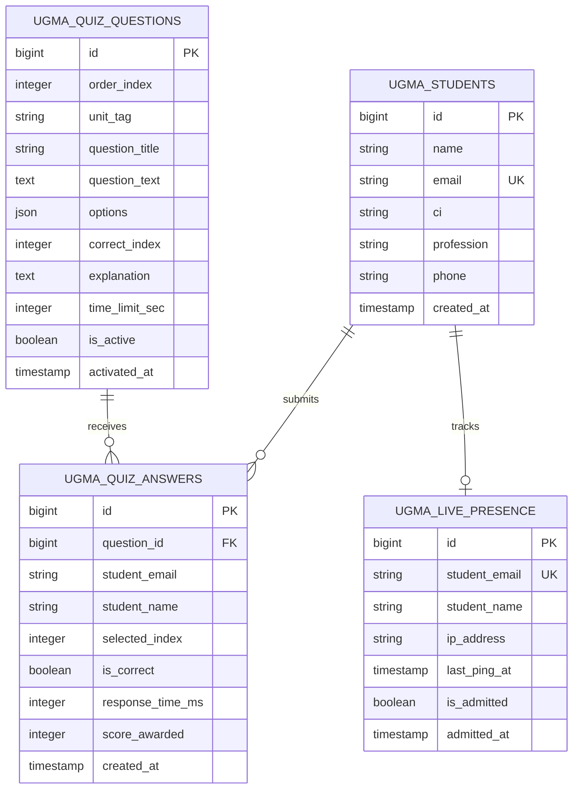

# UGMA Diplomado en Planificación y Gerencia de Obras Specification
**Versión:** 3.0 (Fullstack Docker Laravel 12 · Protocolos 2, 3 y 4)  
**Módulo:** Módulo V: Tecnología y Sostenibilidad en Gerencia de Obras  
**Facilitador Titular:** Ing. Héctor Ramón Mota Zorrilla (CIV / UCV)  
**Estándar Normativo:** EARS (Easy Approach to Requirements Syntax) & RFC 2119  

---

## 1. Purpose & System Overview
Establecer las especificaciones de ingeniería, contratos de API, requerimientos funcionales y criterios de aceptación para el ecosistema fullstack del Módulo V (Tecnología y Sostenibilidad en Gerencia de Obras) de la UGMA. El sistema opera como una aplicación integral en **Laravel 12** ejecutada en un contenedor Docker dedicado (`ugma-app`), expuesto a través de proxy inverso en `aula-gateway` (Nginx), garantizando persistencia centralizada en base de datos SQLite/MariaDB, interactividad en tiempo real (Sala de Espera y Live Quiz tipo Mentimeter), rigor académico, seguridad y blindaje visual inmutable.

---

## 2. Functional Requirements (EARS & RFC 2119)

### Requirement: Arquitectura Fullstack Docker & Enrutamiento Nginx
The system SHALL operate as a dynamic Laravel 12 web application inside a dedicated Docker container (`ugma-app`), listening on an internal port and routed through `aula-gateway` Nginx via reverse proxy for the base path `/ugma-gerencia-obras/`.

#### Scenario: Enrutamiento transparente a Laravel
- **GIVEN** un usuario o cliente HTTP solicita cualquier recurso bajo `https://aula.motazorrilla.com/ugma-gerencia-obras/`
- **WHEN** la solicitud llega al contenedor `aula-gateway`
- **THEN** Nginx SHALL reenviar la petición vía `proxy_pass` al contenedor `ugma-app` preservando headers de host, IP real y protocolo SSL, retornando la respuesta generada por PHP/Laravel.

### Requirement: Articulación Curricular Transversal con Módulos I al IV
The hub page SHALL present a dedicated retrospective section ("Cimientos del Diplomado") articulating the 4 preceding foundation modules:
1. Módulo I: Organización de Obras (Prof. Ing. José Ignacio Pérez)
2. Módulo II: Costos, APU & EVM (Prof. Ing. Rafael Angarita)
3. Módulo III: Marco Legal & Art. 1637 (Prof. Abg. Omar Enrique Martínez)
4. Módulo IV: Lean Construction & Calidad (Prof. Esp. Ing. Diego Zambrano)
Each module card SHALL provide a direct link to its dedicated study page and a direct action to download its Academic Summary in PDF format.

#### Scenario: Descarga contextual de resúmenes de cátedra
- **GIVEN** un estudiante autenticado navega por la sección "Cimientos del Diplomado"
- **WHEN** hace clic en "Descargar Resumen (PDF)" en cualquiera de los módulos I al IV
- **THEN** el sistema SHALL entregar el archivo PDF correspondiente sin redirigir a repositorios o bóvedas externas segregadas.

### Requirement: Las 6 Unidades Curriculares Oficiales (Aprobadas por la UGMA)
The system SHALL provide dedicated routes and interactive learning modules for the 6 official syllabus units:
1. `unidad-1-bim`: Introducción básica al BIM y estándar ISO 19650
2. `unidad-2-digitalizacion-campo`: Tecnología y digitalización en faena (Clash Detection 3D & BCF 3.0)
3. `unidad-3-construcciones-sostenibles`: Fundamentos ESG, LEED v5 y EDGE Buildings
4. `unidad-4-eficiencia-energetica-materiales`: Eficiencia solar fotovoltaica Guayana (5.1 HSP) y materiales ecológicos
5. `unidad-5-gestion-residuos-rcd`: Gestión y valorización circular de residuos de construcción y demolición (RCD)
6. `unidad-6-war-room-integrador`: Taller Integrador de Grado & Simulación de Crisis Edificio Guayana 12P

#### Scenario: Consulta de unidades por estudiantes inscritos
- **GIVEN** un alumno con sesión activa en la plataforma
- **WHEN** pulsa el botón de ingreso a cualquiera de las 6 unidades
- **THEN** la plataforma SHALL cargar la vista correspondiente con código HTTP 200, mostrando el contenido temático oficial, los simuladores de cátedra y las guías técnicas.

### Requirement: Consola y Panel Docente Hipervisible
The system SHALL expose prominent, high-contrast links to the Teacher Administration Dashboard (`/ugma-gerencia-obras/admin`) in the top navigation bar, the hero banner console, and the mobile hamburger drawer. The dashboard SHALL require strict credential authentication (`hector@motazorrilla.com` / `Baralo00.`).

#### Scenario: Autenticación de facilitador
- **GIVEN** el docente accede a `/ugma-gerencia-obras/admin`
- **WHEN** introduce el correo `hector@motazorrilla.com` y la contraseña `Baralo00.`
- **THEN** el sistema SHALL validar la sesión, desbloqueando el panel con la Sala de Espera en vivo, lanzador de Live Quiz, interruptores de módulos y calificador con rúbrica 0-20.

### Requirement: Sala de Espera y Control de Presencia en Tiempo Real
The system SHALL provide an automated heartbeat endpoint (`/api/live/presence/ping`) where connected students emit pings every 30 seconds, storing their online state in `ugma_live_presence`. The teacher SHALL have the capability to admit students individually or in bulk ("Admitir a Todos").

#### Scenario: Latido y admisión a clase
- **GIVEN** un estudiante con sesión iniciada navega en el portal
- **WHEN** su navegador envía un ping de presencia cada 30 segundos
- **THEN** el panel docente SHALL reflejar al estudiante en estado "🟡 En Sala de Espera", y al presionar "Admitir a Todos", su estado cambiará en tiempo real a "🟢 Admitido en Clase".

### Requirement: Motor de Live Quiz Síncrono (Estilo Mentimeter / Kahoot)
The system SHALL incorporate a curated bank of 12 official questions. When the instructor activates a question from the dashboard, all admitted connected students SHALL receive an automated pop-up modal within 4 seconds via polling without exposing the correct answer in the client payload.

#### Scenario: Respuesta y bonificación por velocidad
- **GIVEN** una pregunta de 30 segundos activa en la pantalla del alumno
- **WHEN** el alumno selecciona la opción correcta antes de agotarse el tiempo
- **THEN** el backend SHALL calcular 1,000 puntos base más una bonificación de hasta 500 puntos inversamente proporcional al tiempo de respuesta, registrando la respuesta en `ugma_quiz_answers` e impidiendo envíos duplicados.

### Requirement: Protocolo 4 (Blindaje Estético y Craft Floor Inmutable)
The user interface SHALL preserve 100% of the established visual styles:
- Tipografía oficial: Plus Jakarta Sans (encabezados/cuerpo) y JetBrains Mono (código y telemetría).
- Paleta cromática de alta fidelidad: `--navy-primary: #0f2942`, `--blue-accent: #0284c7`, `--emerald: #059669`.
- Sangría académica en párrafos técnicos (`text-indent: 2.2em`).
- Renderizado de visores 3D WebGL Three.js para modelos paramétricos y detección de interferencias.
- Diseño totalmente responsivo adaptado a dispositivos móviles con menú hamburguesa (`☰` / `✕`).

---

## 3. Data Model & Architecture Specification

